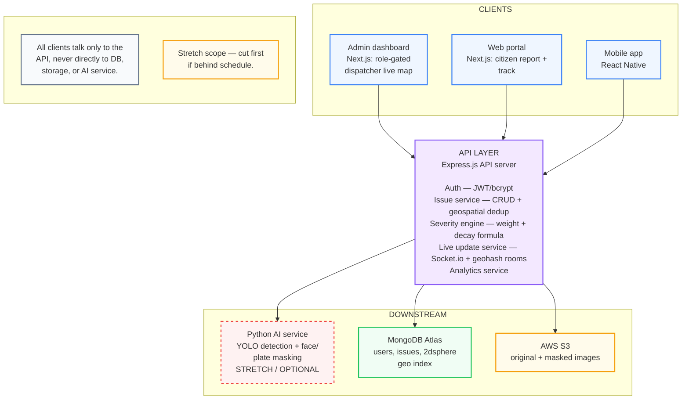

# UrbanOps

Real-time city infrastructure command center. Extends **UrbanLens** (prior semester's citizen-facing mobile reporting app) with a full MERN backend, geospatial deduplication, live dispatch dashboard, and role-gated web clients.

## Problem

UrbanLens lets citizens report issues (potholes, leaks, hazards) via photo + GPS. At scale, the same issue gets reported dozens of times, flooding the city's system with duplicate tickets and no way to prioritize.

## Solution

UrbanOps sits between citizen reports and city dispatchers:

1. **Dedup** — new reports are checked against existing open issues within 100m using the same category. Duplicates increment a counter instead of creating new tickets.
2. **Severity scoring** — each issue gets a score based on category weight, duplicate count, and time decay, so stale or low-impact issues naturally rank lower.
3. **Live dashboard** — dispatchers see new/updated issues instantly via WebSocket, segmented by geohash room (no GeoJSON ward-boundary dependency).
4. **Kanban workflow** — issues move Open → Dispatched → Resolved. No routing/VRP solver in v1 (explicitly scoped out — see PRD).

## Architecture



## Tech Stack

- **Frontend:** React Native (mobile), Next.js (web portal + admin dashboard)
- **Backend:** Node.js, Express.js
- **Database:** MongoDB Atlas (2dsphere geospatial index)
- **Real-time:** Socket.io (geohash-keyed rooms)
- **Storage:** AWS S3
- **Stretch:** Python (YOLO photo masking)

## Core Modules

| Module | Responsibility |
|---|---|
| Auth service | JWT + bcrypt, role-based access (citizen / dispatcher / admin) |
| Issue service | CRUD, `$geoNear` + category dedup |
| Severity engine | `baseWeight + (duplicateCount × multiplier) − (hoursSinceLastReport × decayRate)` |
| Live update service | Socket.io, geohash-prefix rooms |
| Analytics service | Category breakdowns |
| AI masking (stretch) | Separate Python service, YOLO detection + masking |

## Running Locally

Requires Node 20+ and MongoDB (local `mongodb://127.0.0.1:27017` or an Atlas URI).

```bash
# 1. Backend (repo root)
npm install
cp .env.example .env          # set JWT_SECRET; change PORT if 5000 is taken
npm run seed                  # creates admin@urbanops.local / dispatcher@urbanops.local
npm run dev                   # API + Socket.io on http://localhost:5000

# 2. Frontend (new terminal)
cd frontend
npm install
cp .env.example .env.local    # NEXT_PUBLIC_API_URL must match the backend port
npm run dev                   # http://localhost:3000
```

Sign in at `http://localhost:3000/login`:

| Account | Password | Sees |
|---|---|---|
| `dispatcher@urbanops.local` | `dispatch12345` | Dashboard, Kanban board, live map |
| `admin@urbanops.local` | `admin12345` | Same as dispatcher + user management API |
| Register a new account | — | Citizen: report an issue, track "My reports" |

Other commands (repo root): `npm test` runs the backend test suite against a throwaway `urbanops_test` database; `npm run demo` walks through the dedup/severity flow against a running server.

### API overview

| Method | Path | Access |
|---|---|---|
| POST | `/api/v1/auth/register`, `/api/v1/auth/login` | Public |
| GET | `/api/v1/auth/me` | Signed in |
| POST | `/api/v1/issues` | Signed in: submit report (dedup + severity) |
| GET | `/api/v1/issues`, `/api/v1/issues/mine`, `/api/v1/issues/:id` | Signed in (citizens get a public view) |
| PATCH | `/api/v1/issues/:id` | Dispatcher/admin: status + assignee |
| GET | `/api/v1/issues/stats` | Dispatcher/admin |
| GET/PATCH | `/api/v1/users`, `/api/v1/users/:id/role` | Admin |

Live updates: connect Socket.io with `auth: { token }`; staff emit `subscribe` with a `bbox` and receive `issue:created` / `issue:updated` for geohash cells in that area only. Citizens receive updates for issues they reported.

## Explicit Scope Cuts

- **No multi-stop routing / VRP solver.** NP-hard, out of scope for a 12–15 week semester project. Kanban board replaces it. Production version would integrate OSRM/Google Directions API.
- **No ward-boundary WebSocket rooms.** Geohash prefix used instead to avoid a GeoJSON boundary-data dependency.
- **AI photo masking is stretch scope**, cut first if behind schedule.

## Team

1RUA24SCS0068 Nishit Patel · 1RUA24SCS0072 Pragun Lal Shrestha · 1RUA24SCS0077 Pranav Adhikari · 1RUA24SCS0118 Unique Bhakta Shrestha . 1RUA24SCS0099 Sameera Simha Jayasimha
